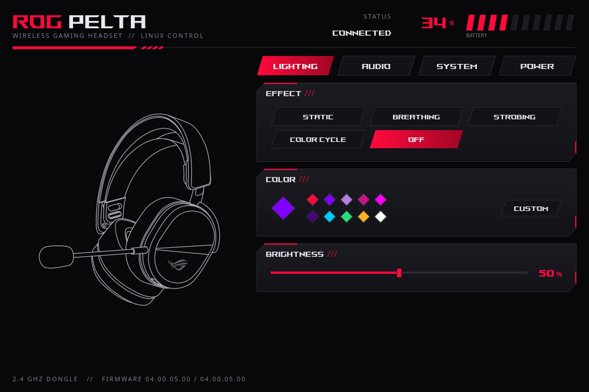
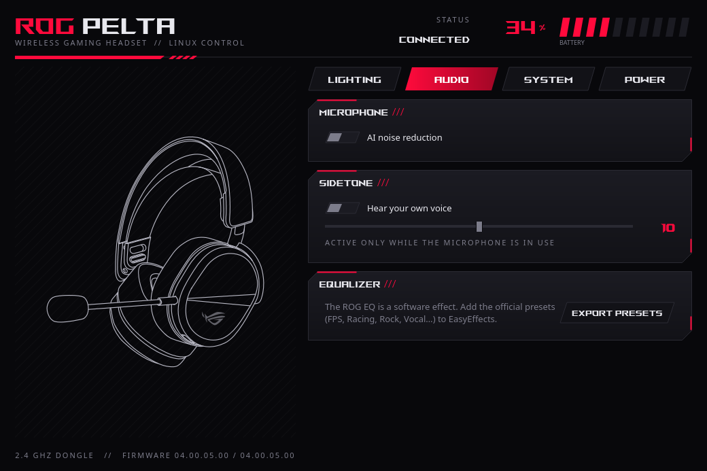
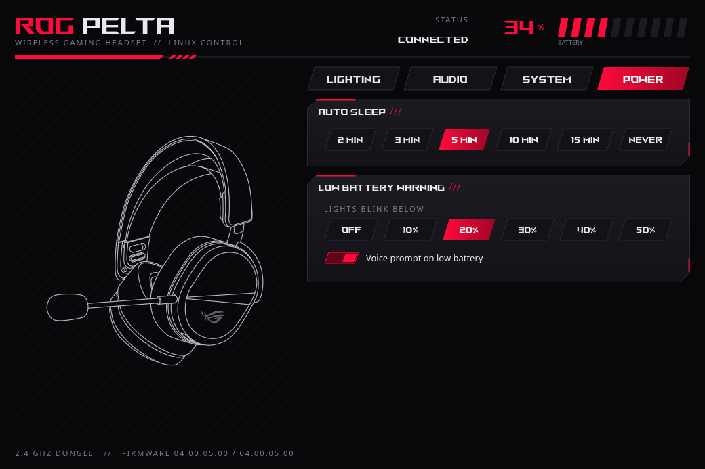

# Pelta Control

Linux control panel, tray battery indicator and CLI for the **ASUS ROG Pelta** wireless headset
(A501, 2.4 GHz dongle `0b05:1b84`). It replaces Armoury Crate on Linux.



The protocol was reverse engineered from ASUS's Windows HAL (`AacAudioHal_x64.dll`, class
`C_A501_Protocol`, ROG PELTA package v1.0.1.14) and checked command by command on real hardware.

Tested on CachyOS with KDE Plasma 6 (Wayland), headset and dongle firmware 4.0.5.0.

| Audio | Power |
|---|---|
|  |  |

## Features

- Battery % and charging state, shown as a tray icon with a low-battery notification
- Lighting: Static / Breathing / Strobing / Color cycle / Off, color, brightness
- AI noise reduction (mic)
- Sidetone on/off and level (0–20). ASUS says sidetone is only active while the mic is in use
- Connection priority: Low latency / Stable connection (2.4 GHz only)
- Voice prompt language (English / Chinese / prompt sound)
- Auto sleep (2/3/5/10/15 min, never), low-battery light threshold, low-battery voice prompt
- Exports the Armoury Crate EQ presets (Classic, Hip hop, Jazz, Metal, Rock, Techno, Vocal, FPS,
  Racing) to EasyEffects. On Windows that EQ is a software effect too; the headset doesn't store it

## Install

Needs Python 3.10+ and PySide6 6.x. On Arch / CachyOS:

```bash
git clone https://github.com/OthrineTM/pelta-control
cd pelta-control
sudo pacman -S pyside6
sudo install -m644 70-rog-pelta.rules /etc/udev/rules.d/ && sudo udevadm control --reload && sudo udevadm trigger --subsystem-match=hidraw
./install.sh
```

The ROG-style UI uses the ROG font and the Pelta line art from ASUS's ROG PELTA package. They
belong to ASUS, so this project doesn't include them: `install.sh` copies them from the package
if it finds it in `~/Downloads` (or from a local `assets/` folder, which git ignores). Without
them the UI falls back to a system font and a generic headset icon.

`install.sh` installs per user into `~/.local/share/pelta-control` and adds a menu entry plus a
tray autostart. Remove everything with `./install.sh --uninstall`.

## CLI

```
pelta-control                     # GUI
pelta-control status
pelta-control battery
pelta-control light static --color 8000ff --brightness 100
pelta-control light off
pelta-control sidetone on | sidetone-level 12
pelta-control nr on
pelta-control latency low | stable
pelta-control sleep 10            # 0 = never
pelta-control export-eq
```

## Protocol

64-byte HID output reports on the dongle's interface 3, report ID `0xCC`. The dongle answers
each one with an input report that echoes the first two bytes. Read replies carry data from
byte 5.

| Function | Read | Write |
|---|---|---|
| Headset connected | `12 00 00 01` → `[0]` | |
| Firmware | `12 00 00 00` → 8 bytes | |
| Power: sleep min, battery %, low-batt %, low-batt voice | `12 07` → `[0..3]` | `51 37 00 00 sleep lvl voice` |
| Charging | `12 08` → `[0]` | |
| Lighting: effect, brightness, R, G, B | `12 03` → `[0..4]` | `51 28 00 00 eff bri R G B` |
| Software (Aura Sync) LED mode | `12 13` | `51 10 00 00 v`, must be 0 for hardware effects |
| Software LED color | | `51 30 00 00 R G B` |
| AI noise reduction | `41 20` → `[0]` | `41 02 00 00 v` |
| Sidetone on/off | `12 24` → `[0]` | `41 11 00 00 v` |
| Sidetone level 0–20 | `12 19` → `[0]` | `61 11 00 00 v` |
| Connection priority | `12 52` → `[0]` | `51 52 00 00 v` (0x28 low latency, 0x64 stable) |
| Voice prompt | `12 28` → `[0]` | `41 0a 00 00 v` (1 English, 2 Chinese, 0 sound) |

Battery `0xFE` = unknown. The headset accepts sleep minutes as a raw value; "never" = `0`
is inferred, not seen in the ASUS code. The USB-C cable mode (`0b05:1b82`) is detected but
untested.

## Firmware updates

Firmware updates still need the ASUS updater on Windows (or a Windows VM with the dongle passed
through). The firmware uses Microsoft CFU and has two banks, but fwupd doesn't know this device yet.

## License

GPL-3.0. Unofficial project, not affiliated with or endorsed by ASUS. ASUS, ROG and ROG Pelta are
trademarks of ASUSTeK Computer Inc.
